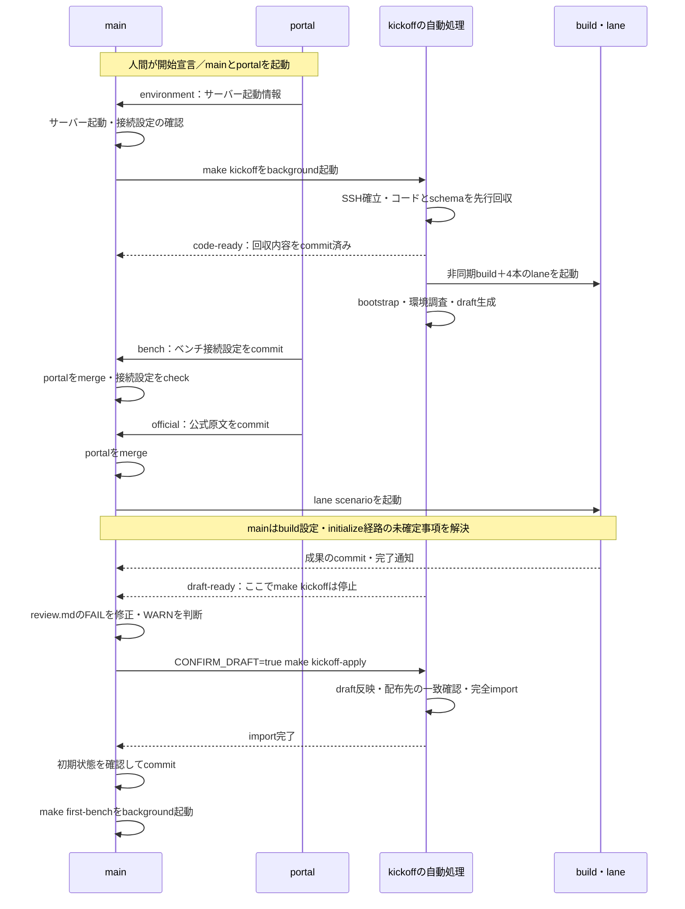
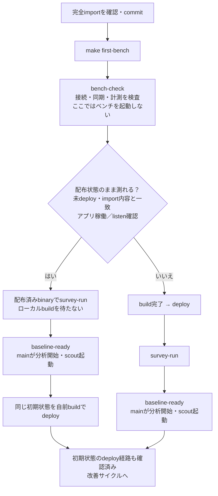
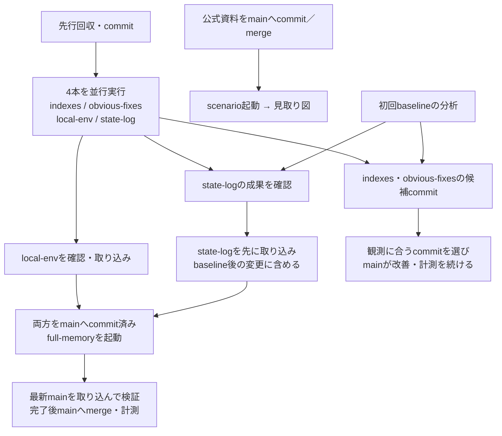

# Agent conversation

- Agent: `codex`
- Session: `01a141ec-1e9c-7061-aa9f-f872b3f9d03f`
- Repository: `isu-scaffold`
- Initial branch: `main`
- Model: `gpt-6-astra`
- Started: 2026-10-16T08:36:28.709+09:00

<!-- agent-event:codex:01a141ec-1e9c-7061-aa9f-f872b3f9d03f:01a141ec-9b3a-7b62-8b86-ef4e948ab9d9:user -->
<!-- agent-head:codex:01a141ec-1e9c-7061-aa9f-f872b3f9d03f:01a141ec-9b3a-7b62-8b86-ef4e948ab9d9:30372098f8d0f7e73bf97f5e06f869993838488d -->
## [User] 2026-10-16T08:36:28.709+09:00

準備、キックオフ、lane、などの初動の流れがよくわからない。よく調査してフローがわかるように効果的に視覚化して。

<!-- agent-events-file -->
詳細ログ: [20261016-083628.events.jsonl](20261016-083628.events.jsonl)

<!-- agent-detail:88b2268223c78849eb9f2e5c -->
- 通知 2026-10-16 08:36:35.117–08:36:35.884 · <code>Bash</code> <code>cat /Users/nao/.codex/plugins/cache/openai-bundled/visualize/1.0.47/skills/visualize/SKILL.md</code> → completed · <code>--- name: visualize description: &quot;Create visualizations and interactive tools directly in conversation. Proactively use …</code> · tool · [詳細:88b22682](20261016-083628.events.jsonl#L5)

<!-- agent-detail:8ab39bc9f52e579fa44eba7e -->
- 通知 2026-10-16 08:36:35.115–08:36:35.955 · <code>Bash</code> <code>cat practice.md</code> → completed · <code># 練習用の事実・注意事項 このファイルはAGENTS.mdの練習用2行から読み込む追加指示であり、全AI・モデル比較実験に適用する。本番へ切り替えるときは、その2行とこのファイルを削除する。日付による自動解除はしない。 ## 今回の練習 …</code> · tool · [詳細:8ab39bc9](20261016-083628.events.jsonl#L6)

<!-- agent-detail:11bebee023c0fc6b678b8d98 -->
- 通知 2026-10-16 08:36:35.122–08:36:36.160 · <code>Bash</code> <code>git status --short &amp;&amp; rg --files -g &#x27;AGENTS.md&#x27; -g &#x27;*kickoff*&#x27; -g &#x27;*preparation*&#x27; -g &#x27;*lane*&#x27; -g &#x27;*automation*&#x27; -g &#x27;*first-bench*&#x27; -g &#x27;*bootstrap*&#x27; -g &#x27;*main*&#x27; …</code> → completed · <code>M AGENTS.md ?? docs/agent-history/20261016-083401.events.jsonl ?? docs/agent-history/20261016-083401.md ?? docs/agent-hi…</code> · tool · [詳細:11bebee0](20261016-083628.events.jsonl#L7)

<!-- agent-detail:09699c86f9d0251a8239259b -->
- 通知 2026-10-16 08:36:40.062–08:36:40.823 · <code>Bash</code> <code>sed -n &#x27;110,215p&#x27; /Users/nao/.codex/plugins/cache/openai-bundled/visualize/1.0.47/skills/visualize/SKILL.md</code> → completed · <code>### UI mockups - For alternative designs of the same component or screen, read [Variant carousel](tweak.md#variant-carou…</code> · tool · [詳細:09699c86](20261016-083628.events.jsonl#L12)

<!-- agent-detail:c400d2882b5459d80dfbac15 -->
- 通知 2026-10-16 08:36:40.071–08:36:40.975 · <code>Bash</code> <code>cat config/lanes.json scripts/kickoff.sh scripts/first-bench.sh</code> → completed · <code>{ &quot;description&quot;: &quot;AI lanes: each runs `claude -p` once in its own worktree and branch (lane/&lt;name&gt;), commits there and s…</code> · tool · [詳細:c400d288](20261016-083628.events.jsonl#L13)

<!-- agent-detail:470d4fa03418cab7b98c28c2 -->
- 通知 2026-10-16 08:36:40.079–08:36:41.090 · <code>Bash</code> <code>cat docs/guides/preparation.md docs/guides/kickoff.md</code> → completed · <code># 準備: 本番開始前にすること ## 目的と境界 本番開始前に許され、かつ問題固有の情報なしで実施できる準備を終える。開始時には、問題公開後にしかできない作業だけが残る状態にする。repo作成だけで準備完了とはしない。 開始後に初めて分か…</code> · tool · [詳細:470d4fa0](20261016-083628.events.jsonl#L14)

<!-- agent-detail:1475f97d7faf5d2d97041cd7 -->
- 通知 2026-10-16 08:36:40.133–08:36:41.209 · <code>Bash</code> <code>cat .claude/commands/main.md .claude/commands/portal.md &amp;&amp; sed -n &#x27;1,260p&#x27; docs/reference/automation.md</code> → completed · <code>Warning: truncated output (original token count: 13104) Total output lines: 333 --- description: このセッションをmain（deploy・ベンチ…</code> · tool · [詳細:1475f97d](20261016-083628.events.jsonl#L15)

<!-- agent-detail:d5118d3758bfcded86d3fefe -->
- 通知 2026-10-16 08:36:45.608–08:36:46.198 · <code>Bash</code> <code>sed -n &#x27;100,240p&#x27; docs/guides/kickoff.md &amp;&amp; cat config/lanes.json</code> → completed · <code>portalのセッション（`/portal`）が、大会運営から提供された情報を`docs/official/`へ保存する。 対象には次を含める。 - レギュレーション - 問題文 - アプリケーションマニュアル - API仕様 - 参加者向…</code> · tool · [詳細:d5118d37](20261016-083628.events.jsonl#L17)

<!-- agent-detail:18f9f39ba46e9fc55d8ba94f -->
- 2026-10-16 08:36:45.820 · <code>Bash</code> <code>null</code> → success exit=0 · 0.007875ms · 補足 · tool · [詳細:18f9f39b](20261016-083628.events.jsonl#L18)

<!-- agent-detail:7c194387bcfd2c42a215b370 -->
- 通知 2026-10-16 08:36:49.162–08:36:49.738 · <code>Bash</code> <code>cat scripts/kickoff.sh scripts/first-bench.sh scripts/kickoff-apply.sh</code> → completed · <code>#!/usr/bin/env bash set -euo pipefail # One entry point for the first hour: early code import, the asynchronous build an…</code> · tool · [詳細:7c194387](20261016-083628.events.jsonl#L20)

<!-- agent-detail:24b3cbb54d77da1268c8945b -->
- 2026-10-16 08:36:49.364 · <code>Bash</code> <code>null</code> → success exit=0 · 0.007542ms · 補足 · tool · [詳細:24b3cbb5](20261016-083628.events.jsonl#L21)

<!-- agent-detail:c3b3446f026e1ad5db2caf8d -->
- 通知 2026-10-16 08:36:55.820–08:36:56.559 · <code>Bash</code> <code>cat .claude/commands/main.md .claude/commands/portal.md &amp;&amp; sed -n &#x27;75,101p&#x27; docs/guides/kickoff.md &amp;&amp; rg -n &#x27;^##|^###|kickoff|first-bench|probe|full-memory|scen…</code> → completed · <code>Warning: truncated output (original token count: 10104) Total output lines: 167 --- description: このセッションをmain（deploy・ベンチ…</code> · tool · [詳細:c3b3446f](20261016-083628.events.jsonl#L23)

<!-- agent-detail:41dfa8adfb1c017516014ebc -->
- 2026-10-16 08:36:56.089 · <code>Bash</code> <code>null</code> → success exit=0 · 0.01425ms · 補足 · tool · [詳細:41dfa8ad](20261016-083628.events.jsonl#L24)

<!-- agent-detail:7324618d321fa1f5874111ee -->
- 通知 2026-10-16 08:37:01.689–08:37:02.410 · <code>Bash</code> <code>sed -n &#x27;49,112p&#x27; docs/reference/automation.md &amp;&amp; sed -n &#x27;319,363p&#x27; docs/reference/automation.md &amp;&amp; sed -n &#x27;1,120p&#x27; docs/roles/scout.md</code> → completed · <code>Warning: truncated output (original token count: 8578) Total output lines: 186 ### AI lane 並行させるAIは、すべてClaude Codeのheadl…</code> · tool · [詳細:7324618d](20261016-083628.events.jsonl#L27)

<!-- agent-detail:40dfb85a6537270844879735 -->
- 2026-10-16 08:37:02.020 · <code>Bash</code> <code>null</code> → success exit=0 · 0.00725ms · 補足 · tool · [詳細:40dfb85a](20261016-083628.events.jsonl#L28)

<!-- agent-detail:8552e65018bc08578832063a -->
- 通知 2026-10-16 08:37:01.692–08:37:02.491 · <code>Bash</code> <code>rg -n &#x27;^def |requires|kickoff|worktree|completed|running|commit|scenario&#x27; scripts/lane.py &amp;&amp; rg -n &#x27;portal|benchmark|isuxportal&#x27; scripts/tool-guard.py &amp;&amp; rg -n …</code> → completed · <code>2:&quot;&quot;&quot;AI lanes: one `claude -p` run per lane, in its own worktree and branch, merged by main. 5: lane.py kickoff start th…</code> · tool · [詳細:8552e650](20261016-083628.events.jsonl#L29)

<!-- agent-detail:67bfbafb6e85880fcd664c92 -->
- 通知 2026-10-16 08:37:12.622–08:37:13.891 · <code>Bash</code> <code>cat AGENTS.md &amp;&amp; sed -n &#x27;93,171p&#x27; scripts/lane.py &amp;&amp; sed -n &#x27;344,367p&#x27; scripts/tool-guard.py &amp;&amp; sed -n &#x27;20,85p&#x27; Makefile</code> → completed · <code># Repository instructions このリポジトリは、一人参加のISUCONでコードと設定をローカルから管理・デプロイするためのものです。作業はClaude Codeで行う。 この`AGENTS.md`を指示の正本とし、Cl…</code> · tool · [詳細:67bfbafb](20261016-083628.events.jsonl#L32)

<!-- agent-detail:6d447dc894449a595300d2e5 -->
- 2026-10-16 08:37:13.086 · <code>Bash</code> <code>null</code> → success exit=0 · 0.016417ms · 補足 · tool · [詳細:6d447dc8](20261016-083628.events.jsonl#L33)

<!-- agent-detail:2db2a3fd417fa13d96b79e4a -->
- 通知 2026-10-16 08:37:12.747–08:37:13.997 · <code>Bash</code> <code>nl -ba scripts/kickoff.sh | sed -n &#x27;38,106p&#x27; &amp;&amp; nl -ba scripts/kickoff-apply.sh | tail -12 &amp;&amp; nl -ba docs/guides/kickoff.md | sed -n &#x27;80,94p&#x27; &amp;&amp; nl -ba .claude/…</code> → completed · <code>38 source_node=${CODE_SOURCE_NODE:-$(jq -r &#x27;.all.children.application.hosts | keys[0] // empty&#x27; &quot;${inventory}&quot;)} 39 test…</code> · tool · [詳細:2db2a3fd](20261016-083628.events.jsonl#L34)

<!-- agent-event:codex:01a141ec-1e9c-7061-aa9f-f872b3f9d03f:01a141ec-9b3a-7b62-8b86-ef4e948ab9d9:codex -->
## [Codex] 2026-10-16T08:38:06.663+09:00

初動は、**mainが全体を進め、portalが必要情報を集め、laneが別の作業場所で成果を作る**構成です。mainは届いた成果を判断して取り込み、deployとベンチを担当します。

手順書とスクリプトを照合すると、**「kickoffという段階」と「`make kickoff`というコマンド」の範囲が違う**ことが、わかりにくさの大きな原因です。

| 呼び方 | 範囲 |
|---|---|
| 準備 | 開始前。道具・認証・テスト・作業場所を整える |
| kickoffという段階 | 開始後の環境構築から、初回ベンチ分析・最初の改善まで |
| `make kickoff` | 先行回収、並行処理の起動、環境整備、**draft作成まで** |
| `make kickoff-apply` | 判断済みdraftの反映と完全importまで |
| `make first-bench` | 接続・計測の検査、初回baseline、初期状態のdeploy |

根拠：[kickoff手順](/Users/nao/project/isucon/isu-scaffold/docs/guides/kickoff.md)、[自動化の仕様](/Users/nao/project/isucon/isu-scaffold/docs/reference/automation.md)。

**開始前に人間が整えるもの**は、次の3つに分けると把握しやすくなります。

| 準備するもの | 開始時にどう使うか |
|---|---|
| 独立したprivate repo、CLI・Rust・Docker・Ansible・運用スクリプトの検証 | mainがすぐ環境構築を始められる |
| chrome-debugとポータルへのログイン、`portal` worktree | 別セッションで`/portal`を開始できる |
| `human` worktree、意見・コードの投稿経路 | 人間がmainの作業ツリーを触らず参加できる |

確認結果は`docs/preparation/readiness.md`へ残します。今回の練習では、アプリ・schema・初期データの取得は開始宣言後です。開始時は、repoのrootでClaude Codeを起動して **`/main` → `/goal`**、別途`portal` worktreeで **`/portal`** を実行します。目標とともに変更を止める時刻も決めます。[準備手順](/Users/nao/project/isucon/isu-scaffold/docs/guides/preparation.md)

次の図は上から下へ進みます。横向きの矢印が、担当間の受け渡しです。各列の作業は並行します。



この間の連絡先は **`.local/progress.log`** です。mainはコマンド全体の終了を待つのではなく、`environment`、`code-ready`、`official`、`draft-ready`などの通知に応じて進みます。

draftは、配置先・service・nodeの役割・同期対象などの**設定候補**です。`CONFIRM_DRAFT=true`は、その候補を確認したという指定で、毎回人間の承認を求める意味ではありません。mainが根拠を確認して判断できます。また、`make kickoff`自体にはEC2作成は含まれません。[実装](/Users/nao/project/isucon/isu-scaffold/scripts/kickoff.sh)

**初回ベンチでは、buildの完了を待たずに測れる分岐があります。** baselineは、改善前の比較基準になる計測です。



通常は左の経路で待ち時間を短縮します。途中で配布対象を変更した場合、baseline後の自動deployは省略されます。FAILならその段階で停止し、結果の読み方が未確定のPENDINGなら、保存済み出力を確認して判定を確定させます。[first-bench実装](/Users/nao/project/isucon/isu-scaffold/scripts/first-bench.sh)

**laneは「仕事を1つ渡して、commitを持ち帰らせる担当」です。** 自分のworktreeと`lane/<名前>` branchで動き、終了します。mainへの取り込みやdeployは自動ではありません。

| lane | 起動のきっかけ | 持ち帰るもの | mainへの取り込み |
|---|---|---|---|
| `indexes` | kickoffが自動起動 | 索引を1件1commit | baseline分析後、効くものを選ぶ |
| `obvious-fixes` | kickoffが自動起動 | 索引以外の自明な修正を1件1commit | baseline分析後、効くものを選ぶ |
| `local-env` | kickoffが自動起動 | ローカル実行環境 | 確認後、baseline前でも可 |
| `state-log` | kickoffが自動起動 | 状態ログの実装・対象の記録 | baseline後、他のコード変更laneより先 |
| `scenario` | 公式資料をmainに取り込んだ後、mainが起動 | 得点・API・SQL・失敗条件の見取り図 | 確認後、baseline前でも可 |
| `full-memory` | `state-log`と`local-env`をmainに取り込んだ後、mainが起動 | 全メモリ化。書き込みはDBに残す | 完了後にmergeしてベンチで評価 |

取り込みの依存関係は、こうなります。



ここで待つ必要がないものは明確です。

- **初回baselineは、lane全員の完成を待ちません。** ローカル環境の完成も必須条件ではありません。
- `indexes`・`obvious-fixes`は、lane全体の終了前でも、完成したcommitを選んで取り込めます。
- `full-memory`は、`indexes`・`obvious-fixes`の完了や、起動直前の変更のベンチ結果を待ちません。実行中もmainは改善を続けます。

起動状況は`make lanes`、成果の確認は`python3 scripts/lane.py status <名前>`です。[laneの取り込み手順](/Users/nao/project/isucon/isu-scaffold/docs/guides/kickoff.md:80)、[lane設定](/Users/nao/project/isucon/isu-scaffold/config/lanes.json)

なお、**scoutはlaneとは役割が違います。** 初回baseline後に自動起動し、探索結果を報告します。各報告の8分後に新しいセッションで再探索する継続担当です。laneは成果のcommit、scoutは見落としや改善候補の報告をmainへ渡します。[scout手順](/Users/nao/project/isucon/isu-scaffold/docs/roles/scout.md)

調査では、説明を読むだけでは解消できない食い違いも見つかりました。

| 箇所 | 現在の食い違い |
|---|---|
| 先行回収直後のlane起動 | 手順は早期起動を意図していますが、実装は**残りnodeのSSH処理の終了を待ってから**commit・`code-ready`・lane起動へ進みます。[該当箇所](/Users/nao/project/isucon/isu-scaffold/scripts/kickoff.sh:49) |
| `kickoff-apply`終了時の案内 | 表示は`make deploy && make bench-check`ですが、現行手順は**完全importをcommitして`make first-bench`**です。[該当箇所](/Users/nao/project/isucon/isu-scaffold/scripts/kickoff-apply.sh:32) |
| portalの試験ベンチ | `/portal`には接続作成時に実ベンチを回す指示があります。一方、AGENTSはベンチをmain専任としています。**接続確認用の試運転と、isuscopeで記録するbaselineの区別・担当が統一されていません。** [該当箇所](/Users/nao/project/isucon/isu-scaffold/.claude/commands/portal.md:31) |

さらに、`state-log`の「baseline後の最初のdeploy」という表現は、`first-bench`が行う「同じ初期状態のdeploy」と紛らわしくなっています。上の図では、初期状態のdeploy経路を確かめ、その後の**最初の変更をdeployするときにstate-logを先に含める**流れとして整理しています。

<!-- agent-event:codex:01a141ec-1e9c-7061-aa9f-f872b3f9d03f:01a141ee-808a-74f3-a11c-a370743b1b20:user -->
<!-- agent-head:codex:01a141ec-1e9c-7061-aa9f-f872b3f9d03f:01a141ee-808a-74f3-a11c-a370743b1b20:dbb1f225a4dc0fa71e465cb7a9761fdf1c5fb53c -->
## [User] 2026-10-16T08:38:32.641+09:00

いや、テキストじゃなくて、htmlとか使って

<!-- agent-detail:a10d92b57096c3592e1ed6af -->
- 通知 2026-10-16 08:38:40.760–08:38:41.323 · <code>Bash</code> <code>cat /Users/nao/.codex/plugins/cache/openai-bundled/visualize/1.0.47/skills/visualize/SKILL.md</code> → completed · <code>--- name: visualize description: &quot;Create visualizations and interactive tools directly in conversation. Proactively use …</code> · tool · [詳細:a10d92b5](20261016-083628.events.jsonl#L38)

<!-- agent-detail:c84bef41fca9f06fec706d67 -->
- 2026-10-16 08:38:40.984 · <code>Bash</code> <code>null</code> → success exit=0 · 0.168042ms · 補足 · tool · [詳細:c84bef41](20261016-083628.events.jsonl#L39)

<!-- agent-detail:ca02781f0d57b1d03d2487a5 -->
- 通知 2026-10-16 08:38:41.849–08:38:42.423 · <code>Bash</code> <code>pwd &amp;&amp; ls /Users/nao/.codex/plugins/cache/openai-bundled/visualize/1.0.47/skills/visualize/scripts &amp;&amp; rg --files .local | head -15</code> → completed · <code>/Users/nao/project/isucon/isu-scaffold render.py .local/lithos-ultra/task-bench-tiers-v2.py .local/lithos-ultra/opencode…</code> · tool · [詳細:ca02781f](20261016-083628.events.jsonl#L41)

<!-- agent-detail:a859e7b306e7c793a396511d -->
- 2026-10-16 08:38:42.085 · <code>Bash</code> <code>null</code> → success exit=0 · 0.008417ms · 補足 · tool · [詳細:a859e7b3](20261016-083628.events.jsonl#L42)

<!-- agent-detail:8d9e6e2ffdb6747c737140b7 -->
- 通知 2026-10-16 08:39:04.874–08:39:05.555 · <code>Bash</code> <code>sed -n &#x27;1,160p&#x27; /Users/nao/.codex/plugins/cache/openai-bundled/visualize/1.0.47/skills/visualize/scripts/render.py &amp;&amp; node --version &amp;&amp; python3 -c &#x27;import impor…</code> → completed · <code>from __future__ import annotations import argparse import re import sys from html import escape from http.server import …</code> · tool · [詳細:8d9e6e2f](20261016-083628.events.jsonl#L44)

<!-- agent-detail:bcc032fcc66a44fa5bea548c -->
- 2026-10-16 08:39:05.210 · <code>Bash</code> <code>null</code> → success exit=0 · 34.819333ms · 補足 · tool · [詳細:bcc032fc](20261016-083628.events.jsonl#L45)

<!-- agent-detail:a9310065c850cb3233de1fa0 -->
- 通知 2026-10-16 08:41:50.219–08:41:50.777 · <code>Bash</code> <code>mkdir -p .local/visualizations/initial-flow</code> → completed · tool · [詳細:a9310065](20261016-083628.events.jsonl#L47)

<!-- agent-detail:9c8d0a42ebcccb7ced60c1e3 -->
- 2026-10-16 08:41:50.439 · <code>Bash</code> <code>null</code> → success exit=0 · 0.009292ms · 補足 · tool · [詳細:9c8d0a42](20261016-083628.events.jsonl#L48)

<!-- agent-detail:dcb9426065f0222d7aab454f -->
- 通知 2026-10-16 08:41:51.327–08:41:51.831 · <code>apply_patch</code> <code>*** Begin Patch *** Add File: /Users/nao/project/isucon/isu-scaffold/.local/visualizations/initial-flow/initial-flow.html +&lt;div id=&quot;isu-initial-flow&quot;&gt; + &lt;style&gt;…</code> → completed · <code>Exit code: 0 Wall time: 0 seconds Output: Success. Updated the following files: A /Users/nao/project/isucon/isu-scaffold…</code> · tool · [詳細:dcb94260](20261016-083628.events.jsonl#L50)

<!-- agent-detail:15f1a2835e3b68a0709775d9 -->
- 通知 2026-10-16 08:42:08.923–08:42:11.294 · <code>mcp__playwright__browser_navigate</code> <code>{&quot;url&quot;: &quot;http://127.0.0.1:8794/preview.html&quot;}</code> → completed · <code>{&quot;content&quot;: [{&quot;type&quot;: &quot;text&quot;, &quot;text&quot;: &quot;### Ran Playwright code\n```js\nawait page.goto(&#x27;http://127.0.0.1:8794/preview.ht…</code> · tool · [詳細:15f1a283](20261016-083628.events.jsonl#L53)

<!-- agent-detail:9efd8c8ca88ab3e3c634c143 -->
- 通知 2026-10-16 08:42:11.854–08:42:14.730 · <code>mcp__playwright__browser_run_code_unsafe</code> <code>{&quot;code&quot;: &quot;async (page) =&gt; { await page.setViewportSize({width:768,height:1100}); const f=page.frameLocator(&#x27;iframe&#x27;); await f.locator(&#x27;.node&#x27;).first().waitFor()…</code> → completed · <code>{&quot;content&quot;: [{&quot;type&quot;: &quot;text&quot;, &quot;text&quot;: &quot;### Result\n[{\&quot;view\&quot;:\&quot;overview\&quot;,\&quot;nodes\&quot;:17,\&quot;title\&quot;:\&quot;full-memory\&quot;,\&quot;edge…</code> · tool · [詳細:9efd8c8c](20261016-083628.events.jsonl#L55)

<!-- agent-detail:3bb6713f76f28bea4e9abfae -->
- 通知 2026-10-16 08:42:22.508–08:42:23.323 · <code>mcp__playwright__browser_take_screenshot</code> <code>{&quot;scale&quot;: &quot;css&quot;, &quot;fullPage&quot;: true}</code> → completed · <code>{&quot;content&quot;: [{&quot;type&quot;: &quot;text&quot;, &quot;text&quot;: &quot;### Result\n- [Screenshot of full page](.playwright-mcp/page-2026-10-15T23-42-22-…</code> · tool · [詳細:3bb6713f](20261016-083628.events.jsonl#L57)

<!-- agent-detail:a3ca9c74ba50467d99314657 -->
- 通知 2026-10-16 08:42:24.174–08:42:25.643 · <code>mcp__playwright__browser_run_code_unsafe</code> <code>{&quot;code&quot;: &quot;async (page) =&gt; { const results=[]; for(const width of [768,360,320]){await page.setViewportSize({width,height:1000}); const frame=page.frames().find(…</code> → completed · <code>{&quot;content&quot;: [{&quot;type&quot;: &quot;text&quot;, &quot;text&quot;: &quot;### Result\n[{\&quot;width\&quot;:768,\&quot;view\&quot;:\&quot;overview\&quot;,\&quot;body\&quot;:721,\&quot;viewport\&quot;:721,\…</code> · tool · [詳細:a3ca9c74](20261016-083628.events.jsonl#L59)

<!-- agent-detail:a0d8480e9ed3b5004d3dda3c -->
- 通知 2026-10-16 08:43:06.496–08:43:07.022 · <code>apply_patch</code> <code>*** Begin Patch *** Update File: /Users/nao/project/isucon/isu-scaffold/.local/visualizations/initial-flow/initial-flow.html @@ - #isu-initial-flow .edge { fill…</code> → completed · <code>Exit code: 0 Wall time: 0 seconds Output: Success. Updated the following files: M /Users/nao/project/isucon/isu-scaffold…</code> · tool · [詳細:a0d8480e](20261016-083628.events.jsonl#L61)

<!-- agent-detail:ea7c12c9e99e235dbb228e2c -->
- 通知 2026-10-16 08:43:07.566–08:43:08.371 · <code>Bash</code> <code>python3 /Users/nao/.codex/plugins/cache/openai-bundled/visualize/1.0.47/skills/visualize/scripts/render.py .local/visualizations/initial-flow/initial-flow.html …</code> → completed · <code>warning: the source references window.openai; verify APIs beyond widgetState/setWidgetState before hosting .local/visual…</code> · tool · [詳細:ea7c12c9](20261016-083628.events.jsonl#L63)

<!-- agent-detail:89777364413eb7bfb71b8ce3 -->
- 2026-10-16 08:43:08.011 · <code>Bash</code> <code>null</code> → success exit=0 · 137.1765ms · 補足 · tool · [詳細:89777364](20261016-083628.events.jsonl#L64)

<!-- agent-detail:e3fa51472e554f6a19e8fee2 -->
- 通知 2026-10-16 08:43:16.642–08:43:18.052 · <code>mcp__playwright__browser_run_code_unsafe</code> <code>{&quot;code&quot;: &quot;async (page) =&gt; { await page.reload(); await page.setViewportSize({width:768,height:1100}); const frame=page.frames().find(f=&gt;f!==page.mainFrame()); a…</code> → completed · <code>{&quot;content&quot;: [{&quot;type&quot;: &quot;text&quot;, &quot;text&quot;: &quot;### Result\n{\&quot;title\&quot;:\&quot;state-log ＋ local-env\&quot;,\&quot;connections\&quot;:\&quot;前段：local-env・s…</code> · tool · [詳細:e3fa5147](20261016-083628.events.jsonl#L66)

<!-- agent-detail:e73a5c94784347ec93e2737b -->
- 通知 2026-10-16 08:43:18.600–08:43:19.157 · <code>mcp__playwright__browser_take_screenshot</code> <code>{&quot;scale&quot;: &quot;css&quot;, &quot;fullPage&quot;: true}</code> → completed · <code>{&quot;content&quot;: [{&quot;type&quot;: &quot;text&quot;, &quot;text&quot;: &quot;### Result\n- [Screenshot of full page](.playwright-mcp/page-2026-10-15T23-43-18-…</code> · tool · [詳細:e73a5c94](20261016-083628.events.jsonl#L68)

<!-- agent-detail:012ecfc0b827b24629127e94 -->
- 通知 2026-10-16 08:43:25.662–08:43:26.789 · <code>mcp__playwright__browser_run_code_unsafe</code> <code>{&quot;code&quot;: &quot;async (page) =&gt; { await page.emulateMedia({colorScheme:&#x27;dark&#x27;}); const f=page.frameLocator(&#x27;iframe&#x27;); await f.locator(&#x27;[data-view=\&quot;bench\&quot;]&#x27;).click()…</code> → completed · <code>{&quot;content&quot;: [{&quot;type&quot;: &quot;text&quot;, &quot;text&quot;: &quot;### Result\n{\&quot;title\&quot;:\&quot;配布状態で測れる？\&quot;,\&quot;edges\&quot;:3}\n### Ran Playwright code\n```js…</code> · tool · [詳細:012ecfc0](20261016-083628.events.jsonl#L70)

<!-- agent-detail:72eef78c46adf14194855322 -->
- 通知 2026-10-16 08:43:27.574–08:43:28.318 · <code>mcp__playwright__browser_take_screenshot</code> <code>{&quot;scale&quot;: &quot;css&quot;, &quot;fullPage&quot;: true}</code> → completed · <code>{&quot;content&quot;: [{&quot;type&quot;: &quot;text&quot;, &quot;text&quot;: &quot;### Result\n- [Screenshot of full page](.playwright-mcp/page-2026-10-15T23-43-27-…</code> · tool · [詳細:72eef78c](20261016-083628.events.jsonl#L72)

<!-- agent-detail:3549a6aacfa0031e0a90f37a -->
- 通知 2026-10-16 08:43:28.897–08:43:29.523 · <code>Bash</code> <code>git status --short &amp;&amp; wc -c .local/visualizations/initial-flow/initial-flow.html</code> → completed · <code>M .claude/skills/isucon-main/hooks/register.tsx M .claude/skills/isucon-main/tests/badge.test.tsx M .claude/skills/isuco…</code> · tool · [詳細:3549a6aa](20261016-083628.events.jsonl#L74)

<!-- agent-detail:937eccfb728ecbcb548575b7 -->
- 2026-10-16 08:43:29.168 · <code>Bash</code> <code>null</code> → success exit=0 · 0.008292ms · 補足 · tool · [詳細:937eccfb](20261016-083628.events.jsonl#L75)

<!-- agent-detail:10f9197e4c7350fc649bc28b -->
- 通知 2026-10-16 08:43:34.406–08:43:35.140 · <code>Bash</code> <code>ls -la .playwright-mcp</code> → completed · <code>total 864 drwxr-xr-x 6 nao staff 192 Oct 16 08:43 . drwxr-xr-x 24 nao staff 768 Oct 16 08:42 .. -rw-r--r-- 1 nao staff 7…</code> · tool · [詳細:10f9197e](20261016-083628.events.jsonl#L77)

<!-- agent-detail:10037b8eec473ce692557975 -->
- 2026-10-16 08:43:34.609 · <code>Bash</code> <code>null</code> → success exit=0 · 0.009542ms · 補足 · tool · [詳細:10037b8e](20261016-083628.events.jsonl#L78)

<!-- agent-detail:a01500ec1020fec1608caeb3 -->
- 通知 2026-10-16 08:42:01.629–08:43:35.699 · <code>Bash</code> <code>python3 /Users/nao/.codex/plugins/cache/openai-bundled/visualize/1.0.47/skills/visualize/scripts/render.py /Users/nao/project/isucon/isu-scaffold/.local/visuali…</code> → completed · <code>127.0.0.1 - - [16/Oct/2026 08:42:10] &quot;GET /preview.html HTTP/1.1&quot; 200 - 127.0.0.1 - - [16/Oct/2026 08:43:16] &quot;GET /previ…</code> · tool · [詳細:a01500ec](20261016-083628.events.jsonl#L79)

<!-- agent-detail:a3b31f6fb93607cc17f22083 -->
- 2026-10-16 08:43:35.348 · <code>Bash</code> <code>null</code> → success exit=0 · 93399.729333ms · 補足 · tool · [詳細:a3b31f6f](20261016-083628.events.jsonl#L80)

<!-- agent-detail:a566fc5143eec9066e251523 -->
- 通知 2026-10-16 08:43:44.427–08:43:44.997 · <code>Bash</code> <code>mv .playwright-mcp/page-2026-10-15T23-42-10-891Z.yml .playwright-mcp/page-2026-10-15T23-42-22-756Z.png .playwright-mcp/page-2026-10-15T23-43-18-789Z.png .playwr…</code> → completed · tool · [詳細:a566fc51](20261016-083628.events.jsonl#L82)

<!-- agent-detail:c2a02b009493682a24d751a5 -->
- 2026-10-16 08:43:44.627 · <code>Bash</code> <code>null</code> → success exit=0 · 0.007166ms · 補足 · tool · [詳細:c2a02b00](20261016-083628.events.jsonl#L83)

<!-- agent-event:codex:01a141ec-1e9c-7061-aa9f-f872b3f9d03f:01a141ee-808a-74f3-a11c-a370743b1b20:codex -->
## [Codex] 2026-10-16T08:43:50.887+09:00

visualize{"path":"/Users/nao/project/isucon/isu-scaffold/.local/visualizations/initial-flow/initial-flow.html","title":"準備・kickoff・laneの流れ"}
